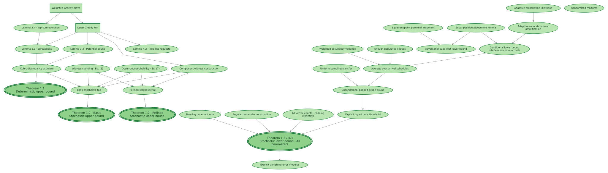

# Online carpooling: Lean formalization

[](https://github.com/milind-prabhu/online-carpooling-lean/actions/workflows/lean.yml)

Lean 4 formalization of **The Cube-Root Phenomenon in Online Carpooling**
by Nikhil Bansal, Milind Prabhu, Sahil Singla, and Siddharth M. Sundaram
([arXiv:2609.21348v1](https://arxiv.org/abs/2609.21348v1)).

The project proves explicit finite versions of the deterministic upper bound,
both stochastic upper bounds, and the stochastic lower bound. The lower bound
includes regular graph construction for every admissible vertex count in its
logarithmic-degree regime, real-log cube-root scaling, an explicit vanishing-error
modulus, and finite randomized mixtures.

## Build and verify

Install [elan](https://github.com/leanprover/elan), then run:

```bash
git clone https://github.com/milind-prabhu/online-carpooling-lean.git
cd online-carpooling-lean
bash bootstrap.sh
bash check.sh
```

The repository pins **Lean 4.24.0** and **mathlib 4.24.0**; `lake-manifest.json`
locks all dependency revisions. The first run downloads the toolchain,
dependencies, and mathlib proof cache. Later checks can use `bash check.sh` directly.

`check.sh` builds all 54 project modules and runs the 84 transitive axiom audits
in [`Audit.lean`](Audit.lean), failing if an audited result depends on `sorryAx`.
The supplied audit reports only `propext`, `Classical.choice`, and `Quot.sound`.
GitHub Actions repeats the build and audit on pushes and pull requests.

## Main results

| Result | Main declarations | Source |
| --- | --- | --- |
| Deterministic upper bound (Theorem 1.1) | `theorem_1_1` | [UpperBounds.lean](Carpooling/UpperBounds.lean) |
| Stochastic upper bounds for batched Greedy (Theorem 1.2) | `theorem_1_2_basic_greedy`, `theorem_1_2_refined_greedy` | [StochasticTheorem.lean](Carpooling/StochasticTheorem.lean) |
| Stochastic lower bound (Theorem 1.3 / 4.3) | `theorem_1_3` | [FinalLower.lean](Carpooling/FinalLower.lean) |
| Error modulus and randomized mixtures | `theorem_1_3_with_error`, `randomized_lower_bound` | [LowerCorollaries.lean](Carpooling/LowerCorollaries.lean) |

All declarations are in the `Carpooling` namespace. See
[the formalization notes](FORMALIZATION.md) for exact hypotheses, constants,
model scope, the complete result-to-declaration table, and correspondence with
the paper. In particular, the stochastic upper bounds use batched local Greedy
states, and probability is modeled by finite sample spaces.

## Explore the proofs

The [interactive blueprint](blueprint/generated/Online_Carpooling_Blueprint.html)
contains all 420 explicitly named declarations, with statements, source excerpts,
and dependencies extracted from compiled Lean terms. Download or clone the
repository and open that HTML file locally; GitHub displays HTML as source.
It is self-contained and works offline.



See [the blueprint documentation](blueprint/README.md) for graph conventions and
rebuild commands (Python 3 and Graphviz are needed only to regenerate the visuals).

## Reproducibility

- [`PROVENANCE.json`](PROVENANCE.json): original source hashes and pinned paper version.
- [`VERIFICATION.txt`](VERIFICATION.txt): verification output supplied with the original archive.
- [`PAPER.txt`](PAPER.txt): text extraction of the pinned paper.
- [`FORMALIZATION.md`](FORMALIZATION.md): detailed documentation supplied with the archive.

Lean sources and the supplied provenance and verification records are preserved
from the archive. Build products and downloaded dependencies are excluded from Git.
